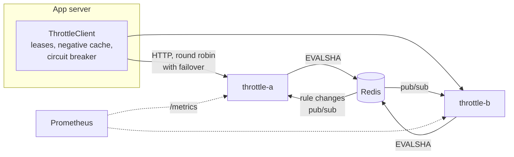

# throttle

A distributed rate limiter on Redis, written in plain Java 21 with no dependencies. Many app servers share one limit, decisions are atomic, and a client library leases tokens in batches, so most decisions never touch the network.

Any API used by more than one customer has someone whose script goes wild and starves everyone else. A limit kept inside each server stops working the moment you run ten servers behind a load balancer, because each one sees only a tenth of the traffic. The limit has to be shared. And the thing that enforces it must not become the thing that takes the API down.

```
POST /v1/check {"rule":"api","key":"tenant-42"}
→ 200 {"allowed":false,"granted":0,"remaining":0,"limit":100,"retryAfterMs":180}
   RateLimit-Limit: 100   RateLimit-Remaining: 0   Retry-After: 1
```

## Results at a glance

On a 2-core VM where the benchmark, two servers and Redis all share the same cores ([full results](bench/RESULTS.md)):

| Mode | Decisions/s | p99 | Backend calls per 1,000 decisions |
| --- | --- | --- | --- |
| Service, one call per decision | 5,341 | 34.5 ms | 1,000 |
| Service, lease 10 | 101,138 | 7.1 ms | 109 |
| Service, lease 100 | 549,647 | 3.8 ms | 17 |
| Library mode, straight to Redis | 53,232 | 3.3 ms | 1,000 |

With four app servers sharing a limit of 1,000 a second, no second of any run allowed more than 1,100, which is the exact bound, with or without leasing. 50 threads making 1,000 attempts against a limit of 500 get exactly 500 for every algorithm, and a test checks that on every push.

## What it does

- **Three algorithms**, each one Lua script, so reading and updating a counter is one atomic step however many servers call at once
- **Rules managed at runtime** through an API, with per-key overrides so a paying tenant gets a higher limit
- **Live rule updates** to every server within milliseconds through Redis pub/sub, with a full reload as a safety net
- **A fail mode per rule.** Open lets traffic through when Redis is down, which suits capacity limits. Closed refuses it, which suits login attempts.
- **A Java client** with token leasing, a negative cache, a circuit breaker and a local fallback that keeps limiting while Redis is away
- **Prometheus metrics** for decisions, latency and Redis errors
- **Two ways to run.** As a service the client talks HTTP to throttle servers. In library mode the client talks straight to Redis.

## Quickstart

You need Java 21+, Maven and Redis.

```bash
git clone https://github.com/vinayakkothari/throttle && cd throttle
docker run -d -p 6379:6379 redis:7          # or brew install redis && redis-server
mvn -B verify                               # builds and runs every test against that Redis

THROTTLE_RULES_FILE=deploy/rules.json java -jar throttle-server/target/throttle-server.jar
```

```bash
curl -s localhost:8080/v1/check -d '{"rule":"login","key":"user@example.com"}'
curl -s localhost:8080/v1/rules
curl -s localhost:8080/metrics | grep throttle_decisions
```

Or run two servers, Redis and Prometheus together with `docker compose up --build`.

To reproduce the benchmark, run `java -jar throttle-bench/target/throttle-bench.jar`. It writes `bench/RESULTS.md`.

## Using the client

```java
ThrottleClient throttle = ThrottleClient.builder(HttpBackend.of("http://throttle-a:8080", "http://throttle-b:8080"))
    .leaseSize(20)                         // take 20 tokens per call, spend them locally
    .leaseTtl(Duration.ofMillis(100))      // unspent tokens expire, which bounds any overshoot
    .fallback(Fallback.local(4))           // if every throttle server is down, keep a quarter of each limit
    .build();

Decision d = throttle.tryAcquire("api", tenantId);
if (!d.allowed()) {
    response.setHeader("Retry-After", String.valueOf((d.retryAfterMillis() + 999) / 1000));
    return 429;
}
```

For library mode, swap the backend for `RedisBackend.connect("redis://cache:6379")`.

## How it works



### Algorithms

| Algorithm | Good for | Memory per key | Exact? |
| --- | --- | --- | --- |
| `token_bucket` (default) | API limits that allow short bursts | one small hash | yes |
| `sliding_window_log` | small strict limits like 5 logins a minute | one entry per request in the window | yes |
| `sliding_window_counter` | large windows like 10,000 a day | one small hash | close estimate |

Every script reads the time from Redis with `TIME` rather than trusting the caller's clock. Two app servers with clocks 300 ms apart still agree on how many tokens have refilled.

Each script returns how long to wait before retrying. A request bigger than the limit returns -1, meaning never, so a client doesn't retry something that can't succeed.

### Leasing

Asking Redis for every decision caps you at one round trip per request. With `leaseSize(n)`, the client asks for up to n tokens at once using a partial grant, then hands them out from memory.

The cost is that a token taken now might be spent up to `leaseTtl` later. So over any window the shared limit can be exceeded by at most `rate × leaseTtl`. That's 100 extra per second for a 1,000/s limit with a 100 ms TTL. In the benchmark that worst case never showed up. Busy servers spend leased tokens straight away, and the busiest second never went past the exact bound.

The other cost is waste. A quiet server can lease tokens it never spends. Partial grants keep this small in practice, because when the bucket is under pressure a lease only gets what is left. With one busy server and three quiet ones, the worst run lost 95 tokens out of 5,100 to expired leases, under 2%.

### Negative cache

When the backend says no and when to retry, the client answers no locally until then. In the accuracy runs, with leasing off, the client made about 32 backend calls per 1,000 decisions, not 1,000, because most of those decisions were denials. A client hammering an exhausted key costs Redis almost nothing. The cache is capped at one second, so a raised limit is noticed quickly.

### When things fail

| What fails | What happens |
| --- | --- |
| Redis, for a throttle server | Each rule's fail mode decides. Responses are marked `degraded` and counted in metrics. `/health` returns 503. Recovery is automatic. |
| One throttle server | The client fails over to the next server in the same call |
| Every throttle server | After 5 failures the circuit breaker opens and calls fail fast. The fallback decides: the rule's fail mode by default, or a local limit at `1/clusterSize` of each rule. One trial call every second checks whether things are back. |
| Pub/sub connection | Missed messages are lost, so every reconnect reloads all rules, and a timer reloads them every 30 s anyway |
| Redis restarts between requests | Pooled connections are all dead. The first failure drops them all and retries once on a fresh connection, so callers get a real answer, not a degraded one. |

The test suite covers this end to end. `RedisOutageTest` puts a TCP proxy between a server and Redis and cuts it mid-test, both during traffic and between requests.

## API

| Method and path | Body | Notes |
| --- | --- | --- |
| `POST /v1/check` | `{"rule","key","cost"?}` | All or nothing. Cost defaults to 1. |
| `POST /v1/acquire` | `{"rule","key","want"}` | Up to `want`, for leasing |
| `GET /v1/rules` | | All rules |
| `GET /v1/rules/{id}` | | One rule |
| `PUT /v1/rules/{id}` | rule JSON | Needs `Authorization: Bearer <THROTTLE_ADMIN_TOKEN>` if set |
| `DELETE /v1/rules/{id}` | | Same |
| `GET /health` | | 200, or 503 when Redis is unreachable |
| `GET /metrics` | | Prometheus text format |

A denied request gets HTTP 200 with `"allowed": false`. The call to the limiter worked and the answer is no. 429 is what your app sends to its own user.

A rule looks like this.

```json
{"id": "api", "algorithm": "token_bucket", "limit": 100, "period": "1s", "burst": 200,
 "failMode": "open", "overrides": {"tenant-enterprise": 1000}}
```

The server is configured with environment variables. `THROTTLE_PORT` defaults to 8080, `THROTTLE_REDIS_URL` to `redis://localhost:6379` (`rediss://` for TLS), and `THROTTLE_REDIS_TIMEOUT` to 200ms. `THROTTLE_REDIS_POOL` defaults to 64, `THROTTLE_PREFIX` to `throttle` and `THROTTLE_RULE_REFRESH` to 30s. `THROTTLE_ADMIN_TOKEN` and `THROTTLE_RULES_FILE` are optional.

## Design decisions

- **No dependencies.** The server is the JDK's HTTP server on virtual threads. Redis is reached with a client for the Redis protocol of about 300 lines, and JSON is handled in one file. The server jar is 56 KB, answers its first request about 250 ms after starting, and has no dependency CVEs to watch. The cost is owning code a library would give me, which is why the protocol and JSON parsers have their own tests.
- **Blocking I/O on virtual threads instead of an event loop.** The Redis client is a pool of plain sockets. A virtual thread parked on a read costs a few hundred bytes, so the code reads top to bottom with no callbacks.
- **Time from Redis, not from callers.** It removes clock skew between app servers. The cost is one `TIME` call inside every script.
- **The algorithm is part of the Redis key.** Switching a rule from token bucket to sliding log starts fresh, instead of failing with WRONGTYPE when a hash is read as a sorted set.
- **Each script touches exactly one key.** The sliding counter keeps both windows in one hash for this reason, so every script stays valid on Redis Cluster without hash tags.
- **No key in metric labels.** Keys are tenant ids and IPs. A label per key would create a time series per caller and take Prometheus down.
- **Fail open by default.** For most APIs a limiter outage that blocks all traffic is worse than one that briefly limits nothing. Abuse-sensitive rules like login opt into closed.
- **Partial grants for leases.** A lease takes whatever is left instead of all or nothing. That keeps quiet servers from hoarding and busy ones from starving.

## Scaling to production

1. **One Redis is the ceiling.** Every decision on a key runs on one Redis core, and a single instance runs tens of thousands of short scripts a second, depending on hardware. Leasing is the first lever, since 17 calls per 1,000 decisions gives about 60 times the headroom.
2. **Redis Cluster for more keys.** Each script uses one key, so keys spread across shards by hash with no code change. To check two rules for one tenant atomically, put the tenant in a hash tag, as in `throttle:{tenant-42}:api`, so both keys land on the same shard.
3. **Hot keys.** One huge tenant still lands on one shard. Larger leases with a short TTL turn that tenant's traffic into a trickle of lease calls.
4. **Several regions.** Each region keeps its own counters and periodically shares usage with the others. A region then enforces the global limit minus what the others report. This trades exactness for not paying cross-region latency on every call.
5. **Adaptive leases.** A fixed lease size wastes tokens on quiet keys and is too small for hot ones. Sizing each lease from that key's recent rate is the natural next step.

## Why not an existing tool?

[Resilience4j's RateLimiter](https://resilience4j.readme.io/docs/ratelimiter) and Guava's limit within one JVM, so they don't solve the shared limit. [Bucket4j](https://bucket4j.com) can keep buckets in Redis and is a solid choice for library mode. [Envoy's rate limit service](https://github.com/envoyproxy/ratelimit) is the standard answer once you run Envoy. This project is about understanding the moving parts. Leasing, the negative cache and fail modes per rule are where the interesting trade-offs live, and the benchmark puts numbers on them.

## Development

```bash
docker run -d -p 6379:6379 redis:7
mvn -B verify          # tests needing Redis are skipped, not failed, if none is running
```

```
throttle-core/    Redis client (Resp, RedisClient, RedisSubscriber), Lua scripts, Rule, Limiter, RuleStore
throttle-server/  ThrottleServer, Metrics, ServerConfig
throttle-client/  ThrottleClient, HttpBackend, RedisBackend, CircuitBreaker, Fallback
throttle-bench/   the speed and accuracy benchmark
deploy/           sample rules and Prometheus config
```

Set `REDIS_URL` to point the tests at another Redis.

## Limitations

- Benchmarked on a small shared VM. The ratios between modes hold, but absolute throughput on real hardware will be higher, and service mode will look better with servers on their own machines. Numbers move a few percent between runs.
- There's no gRPC endpoint yet. HTTP/1.1 with JSON costs more per call than a binary protocol would.
- Rules are global. There's no per-environment namespacing beyond `THROTTLE_PREFIX`.

## License

MIT
